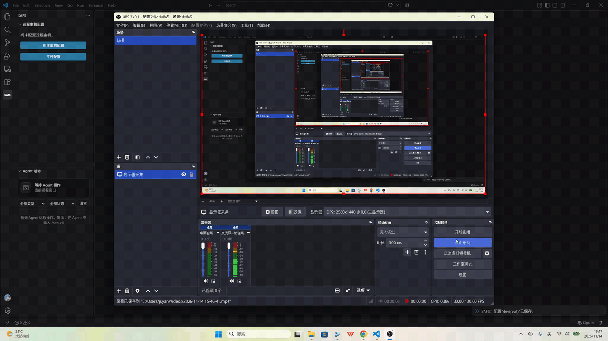

# SAFS

**S**erverless **A**I Coding Agent **F**orwarding for **S**SH

[简体中文](README.md) | [English](README_EN.md)

SAFS 让你在 VS Code 中通过 SFTP 浏览、编辑远程文件，并通过 SSH 使用远程终端；服务器无需安装 VS Code Server。打开 SAFS 远程工作区或终端后，Agent 转发会自动准备，Copilot、Codex、Claude Code 等 AI Coding Agent 可在对应远程目标读写文件、搜索代码和执行命令。




## 适用场景

- 服务器不能或不方便安装 VS Code Server。
- 内网、VPN、跳板机或禁止端口转发的环境。
- 希望 Agent 操作远程代码，但不想在服务器安装 Agent。
- 需要将远程目录同步到本地，继续使用 Git、语言服务器、构建和调试工具。

## 快速开始

### 1. 添加主机账号

1. 安装并启用 SAFS 扩展。
2. 点击左侧活动栏的 **SAFS** 图标。
3. 点击远程目录视图右上角的 **＋**，连续填写主机名、IP 地址、端口和账号凭据。
4. 在已有主机旁点击 **＋**，可以继续追加账号。
5. 首次连接时核对并确认服务器主机密钥指纹。

SSH、终端、命令和 SFTP 全部使用 `ssh2`，不会启动系统 `ssh` 命令作为回退。SAFS 只使用 SAFS 配置中的主机地址、端口和账号，不导入或读取 `~/.ssh/config`，也不自动使用 SSH agent；需要 agent 时显式设置 `auth: "agent"` 或 `agent_socket`。即使 SAFS 中填写的地址和 SSH config 别名相同，也按该地址直连，不会应用 SSH config 规则。若服务器没有可用的 SFTP 子系统，文件传输会在同一 `ssh2` 连接上使用内置 SCP 适配器。

账号支持 `auth`（auto/password/publickey/agent/keyboard-interactive）、`agent_socket`、`proxy_command`、`jump_host`、`socks_proxy` 和 `http_proxy`。`jump_host` 应引用 SAFS 中配置的主机账号；多跳以逗号分隔。sudo 提示匹配当前登录用户后，按 Enter 填入保存密码；其他输入取消，可用 `safs.autoSudoPassword` 关闭。终端 sudo 不改变 SFTP 登录身份。

配置保存在 `~/.safs/config.json`。一般使用界面添加即可；需要手动维护时，可运行 `SAFS: 打开配置`：

```json
{
  "encrypt_passwords": true,
  "hosts": [
    {
      "name": "开发机",
      "ip": "10.0.0.2",
      "accounts": [
        {
          "user": "alice",
          "port": 22,
          "private_key_path": "~/.ssh/id_ed25519"
        }
      ]
    }
  ]
}
```

配置按 SAFS 目录树中的主机、账号分组：`hosts` 是主机，`accounts` 是账号。历史目录继续保存在 VS Code 扩展的全局状态中，不写入 `config.json`。账号只需填写 `user` 和认证信息，内部连接标识由主机名和账号自动生成；界面和 Agent 工作区使用主机名、账号和目录展示。旧版平铺的 `hosts` / `mounts` 配置会自动转换，并保留 `config.json.legacy.bak` 备份。密码、私钥、端口与 VPN 设置保留在对应账号下。

### 2. 打开并编辑远程目录

在 SAFS 视图中点击连接项旁的 **打开远程目录**按钮，或运行 `SAFS: 打开远程目录`。选择目录后，SAFS 会在新窗口中打开 `safs://` 虚拟工作区。

之后可以像编辑本地项目一样浏览、打开、保存、新建、重命名和删除文件。SAFS 会在主机名下记住每个连接最近打开的目录；展开连接项即可从历史记录重新打开。

远程终端默认在当前文件所在目录打开；没有活动文件时使用工作区根目录。终端中的文件路径支持 `Ctrl+点击`（macOS 为 `Cmd+点击`）直接打开。

首次从连接父节点打开配置的远程家目录时，SAFS 会提示当前平台用于“打开远程目录 / 终端”的两个快捷键，之后不再重复显示。

### 3. 让 Agent 操作远程工作区

默认使用 **CLI 模式**，需要本地 **Node.js 18+**。插件自动安装全局 `safs` 命令和 Skill；缺少 Node.js 时，弹窗提供[安装链接](https://nodejs.org/zh-cn)。

安装 Node.js 后，请完全退出所有 VS Code 窗口，再重新打开（仅重新加载窗口不会更新 PATH）。在终端运行 `safs --version` 检查安装，然后在 Agent 中输入 `/safs-cli`，选择远程工作区。

CLI 通过 Unix socket（Windows 使用命名管道）与扩展通信，无需监听本地 TCP 端口。扩展在 Agent 本地工作目录创建 `.safs-workspace-id`，CLI 默认读取当前目录中的文件，不向父目录查找。ID 过期时，按占位符路径唯一匹配活动工作区并写回新 ID。没有文件、匹配失败或有歧义时，使用 `safs workspaces` 查看 ID 并传入 `--id ID`。显式 `--id` 优先且不改写文件；Agent 始终在当前本地工作目录执行 `safs`，不通过 `cd` 或覆盖执行目录来选择工作区；跨多个工作区操作时，在当前目录中为每条命令显式指定 ID。

启用后，Agent可以在当前远程工作区下：

- 列出、读取、搜索、创建和精确修改远程文件；
- 移动、删除、修改权限以及上传或下载文件；
- 在当前远程目录执行命令并分段读取长输出；
- 获取 VS Code 当前打开的远程文件；
- 在多个 SAFS 窗口之间明确选择目标工作区。

#### 查看 Agent 活动

打开 SAFS 活动栏中的 **Agent 活动**，可以实时查看当前远程窗口实际执行的 CLI
操作。顶部动画显示执行中、成功或失败状态，下方时间线按最新操作优先排列，并可按
操作类型和状态筛选。连续的读取、列目录和搜索会自动折叠。

面板顶部只显示当前生效的 **工作区模式** 或 **终端模式**。
打开远程目录时使用工作区模式；没有打开远程目录、只打开 SAFS 远程终端时使用终端模式。
点击 **切换工作区** 可在当前窗口选择并打开远程目录；取消选择时保留当前模式。
SAFS 会读取终端实际目录并把它作为 Agent 的 `workspaceRoot`；命令继承该终端当前的用户
权限和环境变量，下方会显示绑定的终端及目录。

SAFS 视图中的连接条目会用圆点显示 Agent 转发状态。需要恢复时，点击连接旁的 **重启 Agent 转发**。如果 CLI 是通过提示词或 URL 手动安装的，请运行 `SAFS: 为我的Agent卸载转发功能`。

## 文件传输与本地同步

在资源管理器中右键文件或目录：

- **SAFS：可视化下载**：将远程文件或目录下载到本地，支持递归、进度显示和取消。
- **SAFS：可视化上传**：将本地文件或目录上传到选定连接，无需先打开远程工作区。
- **SAFS：同步到本地**（远程目录右键）：等价于"先可视化下载，再开启双向同步"。选本地父目录，先整棵下载到 `<所选目录>/<远程目录名>` 作为首次基线，随后持续进行本地 ↔ 远程双向增量同步；同步完成的目录会写进 SAFS 视图的历史列表，条目上的按钮未同步时是「启动同步」，同步中是「关闭本地同步」。
- **SAFS：可视化同步**（本地文件夹右键）：等价于"先可视化上传，再开启双向同步"。选远程挂载与远程目录，本地目录整棵上传到 `<所选目录>/<本地目录名>`，再以刚上传的远程状态为基线开启双向同步（不会把刚上传的内容重复下载回来，远程独有的内容仍会补齐到本地）；同步成功后自动在新窗口打开本地目录，该远程目录同时进入历史列表，同步按钮显示已开启，可随时关闭同步。

### 大文件断点续传

上传或下载大文件（1 MiB 以上）中断后，再执行一次同一个文件的传输会**从断点继续**，不会从 0 重来。进度提示会显示已有字节数并标注「续传」。

- 续传不依赖 rsync，也不需要远端安装任何东西：SFTP 协议的读写报文自带字节偏移，SAFS 直接用它做定位读写；只有网关没有 SFTP 子系统、退回 `scp` 通道时才退化为整传。
- 中断时残片保留在目标旁边（上传是远端同目录的 `.<文件名>.safs-part-<哈希>`，下载是本地同目录的 `<文件名>.safs-part-<哈希>`），成功提交后会改名到最终位置。
- **源文件变过就不续传**：残片名里编进了源文件的 size+mtime；真正续传前还会分别计算源文件前缀和残片的 SHA-256。元数据或内容任一不一致都会删除残片并自动完整重传，避免把两个版本的字节拼成一个看起来正常的坏文件。
- 小于 1 MiB 的残片不留（续传收益不抵一个垃圾文件），残片超过 7 天会在下一次传输时顺手清掉。

## 远程 Git 源代码管理

保存 SAFS 文件后会自动刷新更改列表；窗口处于前台时，每 2 秒轻量检查一次远程工作区，以发现终端或其他工具直接修改的文件。切回窗口会立即检查。自动检查不拉取、推送或刷新同步状态，手动刷新仍会更新完整状态。

通过 SAFS 打开远程 **Git 仓库根目录** 后，VS Code「源代码管理」会出现 `Git (SAFS)` 仓库。状态、差异、暂存和提交在 SSH 主机上执行，使用远端的 Git 配置和提交身份；推送与拉取都通过本地 Git 中转，使用本地网络和凭据。无需同步工作区到本地或启用 Agent 转发。


## 常用设置

在 VS Code 设置中搜索 `SAFS`：

| 设置 | 默认值 | 用途 |
|---|---:|---|
| `safs.terminalFollowsActiveFile` | `false` | 切换文件时，让已打开的远程终端自动 `cd` 到对应目录 |
| `safs.terminalAutoReconnect` | `true` | 远程终端意外结束后自动重连；瞬时网络错误会有限退避重试 |
| `safs.agentBackendToolProfile` | `full` | 改为 `core` 可减少 Agent 工具定义的上下文开销 |
| `safs.agentBackendTimeoutMs` | `120000` | Agent 命令、搜索和传输的超时；`0` 表示关闭 |
| `safs.sftp.watchInterval` | `5` | 轮询远程文件变化的间隔（秒） |
| `safs.hostKeyChangedAction` | `prompt` | 主机密钥变化时询问、拒绝或接受 |
| `safs.highRiskCommandAction` | `deny` | Agent 命中高风险命令规则时拒绝或放行 |

更多高级选项及说明可直接查看 VS Code 的 SAFS 设置页。

## 工作原理

SAFS 在本地 VS Code 扩展进程中建立 SSH/SFTP 连接，将远程目录映射为 `safs://` 虚拟文件系统。文件浏览与编辑通过 SFTP 完成，终端和 Agent 命令通过 SSH 执行，因此服务器无需安装 VS Code Server 或 Agent。

SAFS 提供 CLI 接口，让 Agent 安全、高效地调用插件的文件操作与远程命令能力。该接口使用插件管理的连接、工作区边界和安全检查，支持结构化文件操作、批量请求与分段读取输出，减少重复连接和不必要的数据传输。

打开 SAFS 远程工作区或终端后，对应窗口会启动仅本机可访问的 CLI 服务。多个窗口共用固定的本地路由入口；每次路由操作都显式携带 `workspaceId`，精确指向目标窗口，避免将命令发到错误的服务器或工作区。

结构化写入被限制在当前远程工作区。Agent 发起的 SSH 命令若命中高风险规则，默认会被拒绝并记录脱敏审计日志。但 SSH 命令不是沙箱：获准执行后仍拥有登录账号的权限，建议使用非 root、最小权限账号并禁用免密提权。

## 限制

- 本地命令行和只支持 `file://` 的扩展不能直接访问 `safs://`；需要时请使用双向同步。
- SFTP 没有原生文件变更通知，SAFS 通过轮询检测远程修改。
- 支持 Agent 转发的 safs CLI 依赖本地 VS Code 持续运行，并保持对应 SAFS 远程工作区或终端打开。
- SFTP 优先使用服务器子系统；不支持时使用同一 `ssh2` 连接上的 SCP 适配器，不调用系统 SSH/SFTP 命令。
- CLI 工具能限制结构化文件操作，但无法拦截 Agent 自己调用的其他本地工具。

## SAFS 与免密 SSH alias 对比

另一种常见的无Agent服务操作远程主机的方式是在 `~/.ssh/config` 中配置主机别名和密钥，让 Agent 直接执行 `ssh dev '命令'`。两者都不需要在远程安装 Agent，但侧重点不同。

| 对比项 | SAFS | 免密 SSH alias |
|---|---|---|
| 上手成本 | 在扩展内添加连接并启用转发，步骤集中 | 需自行配置密钥、`authorized_keys`、alias，并告诉 Agent 正确用法 |
| 浏览与编辑 | 有远程文件树、编辑器集成、历史目录和当前文件感知 | 没有文件树；依赖 `ssh`、`scp`、`rsync` 或 Shell 命令 |
| Agent 工具 | 读取、搜索、精确编辑、传输和命令均为结构化工具 | 主要是自由形式 Shell，灵活但更依赖 Agent 正确解析与修改 |
| 工作区定位 | 绑定当前 SAFS 窗口和目录，多窗口可明确切换 | alias 只定位主机，工作目录需在命令中自行维护 |
| 写入边界 | 结构化写工具限制在当前工作区，另有高风险命令规则 | 默认拥有 SSH 账号的全部权限，没有额外工作区边界 |
| 安全控制 | 主机密钥确认、本地 CLI Token、高危命令拦截与脱敏日志 | 可充分利用 OpenSSH；安全性取决于密钥、账号和服务器权限 |
| 文件传输 | 内置可视化上传、下载和双向同步 | `scp`/`rsync` 成熟通用，适合脚本化和批量传输 |
| 兼容性 | 支持密码、私钥、交互认证、跳板和代理；服务器须提供 SFTP | OpenSSH 能连接即可；特殊网络和交互认证需自行编排 |
| 依赖 | 必须运行 VS Code 与 SAFS；Agent 需支持 SAFS CLI | 只依赖 SSH 客户端和密钥，对编辑器与 Agent 要求较少 |
| 更适合 | 交互式开发，让 Agent 安全操作当前项目 | 已有 SSH 运维体系、CI 脚本和跨工具自动化 |

选择建议：

- 需要文件树、编辑器、同步，并希望 Agent 明确绑定当前工作区：选择 **SAFS**。
- 已有成熟的 SSH 密钥和权限体系，只需执行命令或现有脚本：**SSH alias** 更简单。
- 两者可以并用：日常编辑与 Agent 文件操作走 SAFS，已审查的运维脚本或批量传输走 SSH/rsync。

原生预编译模块覆盖 Windows/macOS x64、arm64 及 Linux glibc x64、arm64、arm；WSL 使用 Linux 模块。

第三方移植来源与许可证见 [THIRD_PARTY_NOTICES.md](THIRD_PARTY_NOTICES.md)。

[源码架构与模块目录](ARCHITECTURE.md)

SAFS 新建的本地占位符使用 `用户@主机@端口远程路径` 格式，例如 `user@192.0.2.1@22home-share-user-folder1`。同一远程目录已有可确认对应的旧占位符时直接复用原目录；不同账号和端口分别管理。
