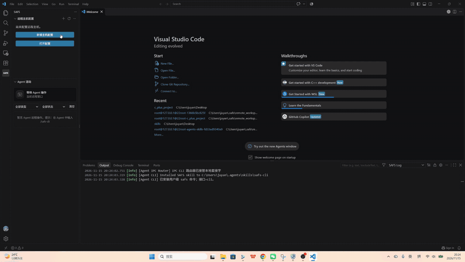
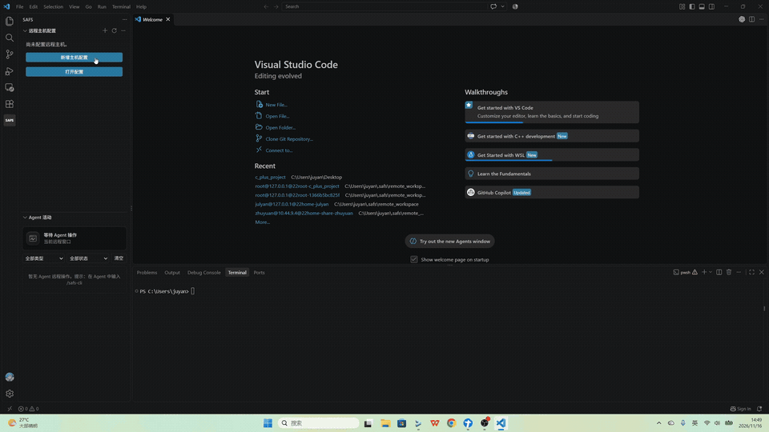
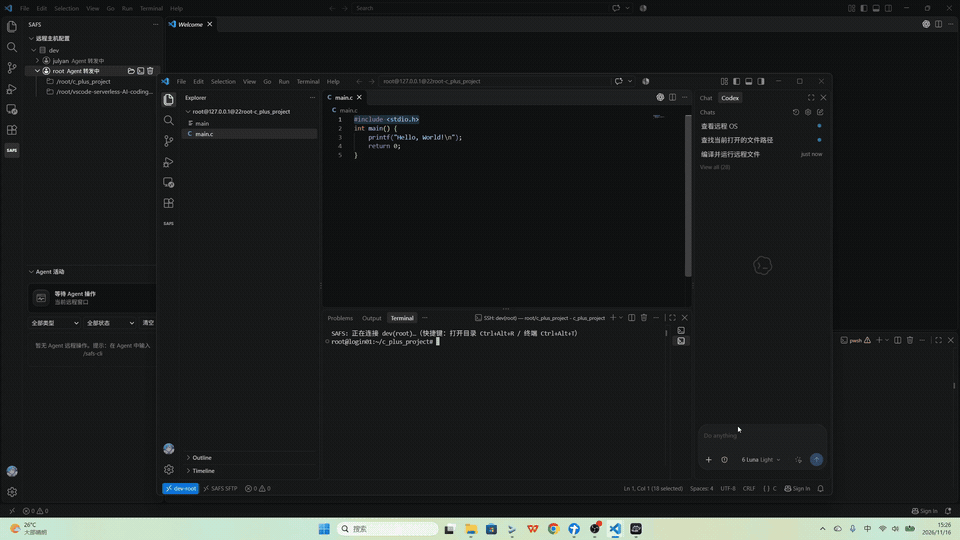
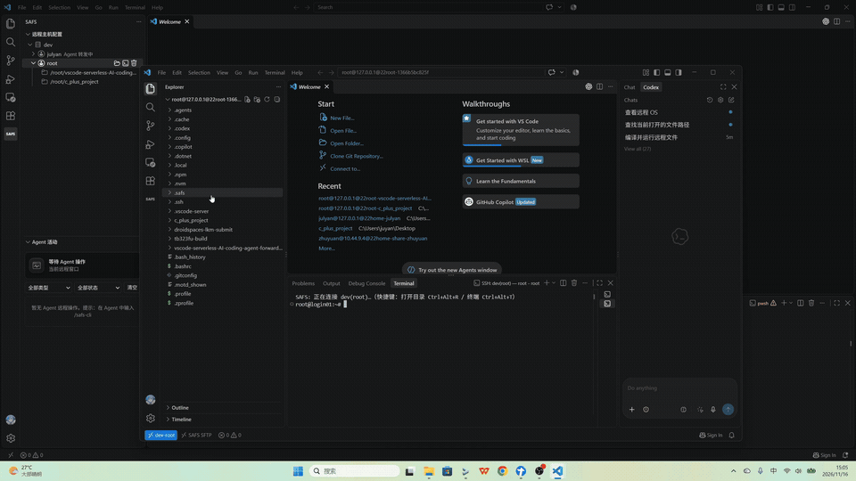

# SAFS

**S**erverless **A**I Coding Agent **F**orwarding for **S**SH

[简体中文](README.md) | [English](README_EN.md)

SAFS 让你在 VS Code 中浏览、编辑远程文件，使用远程终端，并让 AI Coding Agent 操作远程项目。服务器无需安装 VS Code Server 或 Agent。

## 操作演示

### 连接主机

### Agent 转发

### 同步与 Git

## 功能

- **远程文件编辑**：浏览、搜索、打开、保存、新建、重命名和删除远程文件与目录。
- **远程终端**：在远程目录中执行命令，点击终端中的文件路径打开文件。
- **Agent 转发**：让 Copilot、Codex、Claude Code 等 Agent 通过 SAFS CLI 读取、搜索、修改远程文件，传输文件和执行命令。
- **Agent 活动**：查看操作记录、执行状态，并按类型和状态筛选。
- **文件传输**：上传、下载文件与目录，查看进度并取消传输；支持大文件断点续传。
- **双向同步**：将远程目录同步到本地，或将本地目录上传后开启双向同步。
- **远程 Git**：查看更改、文件差异、提交记录和分支，暂存、取消暂存、还原、提交、提取、快进拉取和推送；支持初始化与克隆仓库。
- **连接与目录管理**：管理多个主机和账号，从历史记录重新打开远程目录或终端。

## 快速开始

### 1. 添加主机账号

1. 安装并启用 SAFS 扩展。
2. 点击左侧活动栏的 **SAFS** 图标。
3. 点击远程目录视图中的 **＋**，填写主机名、地址、端口和账号，并选择 **密码** 或 **密钥** 认证。
4. 首次连接时核对并确认服务器主机密钥指纹。

新增配置时无需输入密码或选择私钥。首次打开远程目录或终端时，密码认证会显示密码输入框及 **记住密码** 勾选项；未勾选时仅在当前窗口会话中使用，勾选后由 VS Code 安全保存。密钥认证会打开文件选择器，选择本地私钥后记住路径。配置文件不保存密码，保留私钥路径字段。

密码和密钥认证最多尝试 3 次（包含首次），失败后可重新输入或选择，取消立即停止。点击主机旁的齿轮可打开对应主机配置；保存后自动更新主机列表，连接参数修改后不再复用旧连接。需要重置密码时，可从命令面板运行 **SAFS：修改登录凭据**，下次连接时重新输入。已有主机可以继续添加其他账号。SAFS 不读取 SSH config，请在扩展中填写实际连接信息。

### 2. 打开远程目录或终端

点击连接旁的 **打开远程目录**，选择要编辑的目录。之后可以在 VS Code 中浏览和编辑远程文件。

点击 **打开远程终端** 可执行远程命令。终端默认在当前文件所在目录打开，没有活动文件时使用工作区根目录。终端文件路径支持 Ctrl+点击打开，macOS 使用 Cmd+点击。

### 3. 使用 Agent 转发

打开 SAFS 远程工作区或终端后，Agent 转发会自动准备。默认使用 CLI 模式，需要本地安装 **Node.js 18+**；按提示完成 SAFS CLI 和 Skill 安装。

安装 Node.js 后，请完全退出所有 VS Code 窗口并重新打开。运行 `safs --version` 检查安装，然后在 Agent 中输入 `/safs-cli`，按提示选择远程工作区。

在 **Agent 活动** 面板查看执行记录与当前目标。打开多个 SAFS 窗口时，请确认 Agent 选择了正确的工作区。需要恢复连接时，可使用 **重启 Agent 转发**。

## 文件传输与同步

在资源管理器中右键文件或目录：

- **SAFS：可视化下载**：将远程文件或目录下载到本地。
- **SAFS：可视化上传**：将本地文件或目录上传到远程。
- **SAFS：同步到本地**：下载远程目录并开启双向同步。
- **SAFS：可视化同步**：上传本地目录并开启双向同步。

同步目录会记录在 SAFS 的历史列表中，可以通过条目上的按钮启动或关闭同步。

大文件传输中断后，重新传输同一个文件可尝试续传；源文件变化或连接不支持续传时，会重新完整传输。

## 远程 Git

打开远程目录后，在 VS Code「源代码管理」侧栏使用 **SAFS Git**。

可查看仓库状态、文件差异、提交记录和分支，逐项或批量暂存、取消暂存及还原更改，并进行提交、提取、快进拉取和推送。没有仓库时，可以初始化或克隆仓库。

保存文件或重新聚焦窗口后会刷新已发现仓库的状态；需要重新发现仓库或更新完整状态时，使用手动刷新。远程 Git 无需开启本地同步或 Agent 转发。

## 常用设置

在 VS Code 设置中搜索 `SAFS`，可调整终端跟随当前文件、终端自动重连、操作超时、远程文件检查间隔，以及主机密钥和高风险命令的处理方式。

## 使用限制

- 本地命令行工具及部分扩展无法直接使用远程工作区；需要本地语言服务、构建或调试时，可将目录同步到本地。
- Agent 转发需要保持本地 VS Code 运行，并保持对应远程工作区或终端打开。
- 远程文件变化可能需要等待自动检查，或手动刷新后才显示。
- Agent 执行远程命令时拥有登录账号的权限，请确认目标账号和目录。

[源码架构与模块目录](ARCHITECTURE.md) · [第三方许可证](THIRD_PARTY_NOTICES.md)
