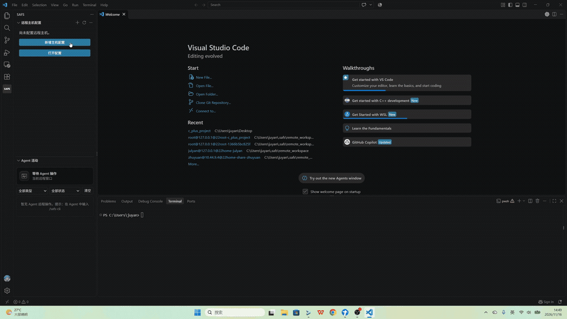
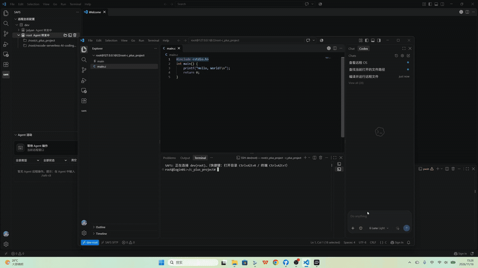
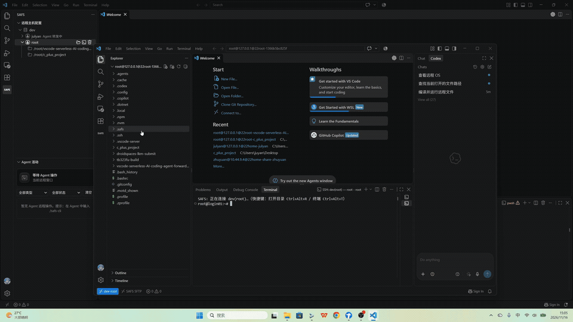

# SAFS

**S**erverless **A**I Coding Agent **F**orwarding for **S**SH

[简体中文](README.md) | [English](README_EN.md)

SAFS lets you browse and edit remote files, use remote terminals, and let AI Coding Agents work on remote projects in VS Code. The server needs neither VS Code Server nor an Agent installed.

## Demos

### Connect to a host

### Agent forwarding

### Sync and Git

## Features

- **Remote editing**: browse, search, open, save, create, rename, and delete remote files and directories.
- **Remote terminals**: run commands in remote directories and open files from terminal paths.
- **Agent forwarding**: let Agents such as Copilot, Codex, and Claude Code use SAFS CLI to read, search, and edit remote files, transfer files, and run commands.
- **Agent activity**: view operation history and execution status, with type and status filters.
- **File transfers**: upload and download files and directories with progress and cancellation; resume large transfers.
- **Two-way sync**: download a remote directory or upload a local directory and keep both copies synchronized.
- **Remote Git**: view changes, diffs, history, and branches; stage, unstage, discard, commit, fetch, fast-forward pull, and push; initialize and clone repositories.
- **Connection management**: manage multiple hosts and accounts, and reopen remote directories or terminals from history.

## Quick start

### 1. Add a host account

1. Install and enable SAFS.
2. Click **SAFS** in the Activity Bar.
3. Click **+** in the Remote Folders view and enter the host name, address, port, and account, then choose **Password** or **Key** authentication.
4. On first connection, verify and accept the server's host-key fingerprint.

Adding a configuration does not ask for a password or key file. When you first open a remote directory or terminal, password authentication shows a password form with a **Remember password** checkbox. Unchecked passwords stay in the current window session only; checked passwords are stored securely by VS Code. Key authentication opens a file picker and saves the selected local private-key path. Configuration files contain no passwords; the private-key path remains in configuration.

Password and key authentication allow at most three attempts, including the first. Retry with a different password or key, or cancel to stop immediately. Click the gear beside a host to open its configuration. Saving updates the host list automatically; changed connection settings invalidate the old connection. To reset a password, run **SAFS: 修改登录凭据** (Edit Login Credentials) from the Command Palette; the next connection asks for credentials. You can add more accounts to an existing host. SAFS does not read SSH config; enter the actual connection details in the extension.

### 2. Open a remote directory or terminal

Click **Open Remote Folder** beside a connection and select a directory. You can then browse and edit remote files in VS Code.

Click **Open Remote Terminal** to run remote commands. The terminal opens in the active file's directory, or at the workspace root when no file is active. Ctrl+click a terminal file path to open it; use Cmd+click on macOS.

### 3. Use Agent forwarding

Opening a SAFS remote workspace or terminal automatically prepares Agent forwarding. The default CLI mode requires local **Node.js 18+**. Follow the prompts to install SAFS CLI and its Skill.

After installing Node.js, fully quit all VS Code windows and reopen VS Code. Run `safs --version` to check installation, then enter `/safs-cli` in your Agent and follow the instructions to select a remote workspace.

Use **Agent Activity** to inspect operations and the current target. When multiple SAFS windows are open, check that your Agent selects the intended workspace. Use **Restart Agent Forwarding** when recovery is needed.

## File transfers and sync

Right-click a file or directory in the Explorer:

- **SAFS: Visual Download** downloads remote files or directories locally.
- **SAFS: Visual Upload** uploads local files or directories.
- **SAFS: Sync to Local** downloads a remote directory and starts two-way sync.
- **SAFS: Visual Sync** uploads a local directory and starts two-way sync.

Synced directories appear in SAFS history. Use the entry's button to start or stop synchronization.

After a large transfer is interrupted, transferring the same file again can resume it. Transfers restart in full if the source changes or the connection does not support resuming.

## Remote Git

Open a remote directory, then use **SAFS Git** in VS Code's **Source Control** sidebar.

View repository status, diffs, history, and branches; stage, unstage, or discard individual or grouped changes; commit, fetch, fast-forward pull, and push. Initialize or clone a repository when needed.

Saving a file or returning focus to the window refreshes known repositories. Use manual refresh to discover repositories or update full status. Remote Git does not require local sync or Agent forwarding.

## Settings

Search for `SAFS` in VS Code Settings to configure terminal directory following, automatic terminal reconnection, operation timeouts, remote file checking intervals, and handling of host keys and high-risk commands.

## Limitations

- Local command-line tools and some extensions cannot use the remote workspace directly. Sync locally when local language services, builds, or debugging are needed.
- Agent forwarding requires local VS Code to remain running with the relevant remote workspace or terminal open.
- Remote file changes may appear after an automatic check or manual refresh.
- Agent commands run with the remote login account's permissions. Check the target account and directory.

[Source architecture and module layout](ARCHITECTURE.md) · [Third-party licenses](THIRD_PARTY_NOTICES.md)
